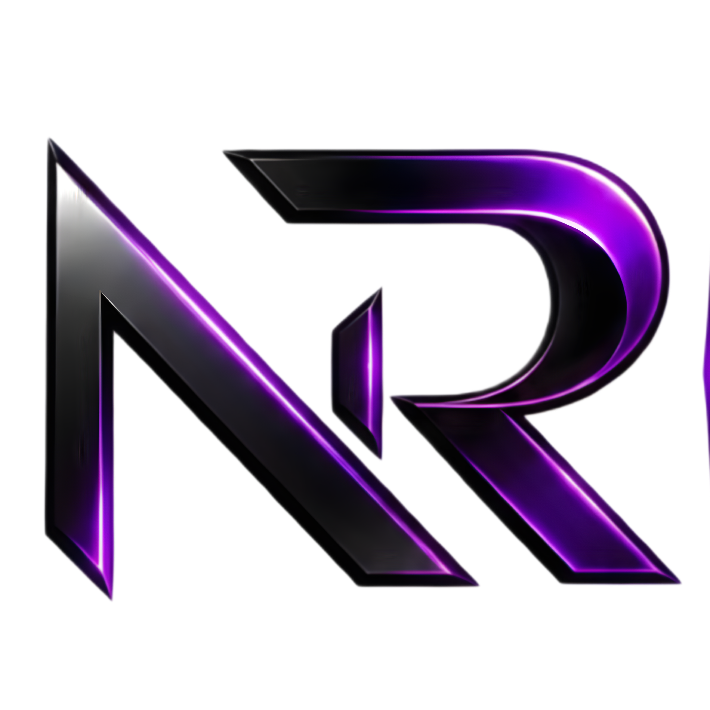

# Nishan Rajak




---

Backend-focused software engineering student building scalable APIs, secure auth flows, and modular backend systems.

## Quick facts

- **Name:** Nishan Rajak (Nishu)
- **Role:** Backend-Focused Software Engineering Student
- **Location:** Raghunathpur, West Bengal
- **Email:** [nishan.developer.dev@gmail.com](mailto:nishan.developer.dev@gmail.com)

## Badges

Tech & tools I'm working with:

<!-- Skill badges: original brand colours from SimpleIcons, logo color chosen for contrast -->


---

## About me

I focus on backend system architecture, API design, and robust authentication. My projects emphasise modular code, clear separation of concerns, and reliable error handling.

> Scalable APIs, secure auth, and modular backend systems.

## Featured projects

- **Devclip Hub** — Developer-focused utility hub with modular frontend architecture and productivity-driven tooling.
  - Tech: Next.js · React · JavaScript · TailwindCSS
- **Gh Control** — Power-user GitHub command center with repo, PR, webhook, and job controls in one dashboard.
  - Tech: Next.js · Node.js · MongoDB · Redis · BullMQ
- **Baksy** — Product-focused full-stack application with scalable backend and polished frontend experiences.
  - Tech: React · Node.js · Express · MongoDB

More projects and links are in the portfolio site.

## Skills

- Backend: Node.js, Express, REST APIs, JWT Authentication, Prisma, Mongoose
- Databases & Tools: MongoDB, MySQL, Postman, Git, GitHub
- Frontend (selected): React, Next.js, TailwindCSS, TypeScript

I also help with frontend tasks such as component-level UI polish, responsive layouts, and accessibility improvements when requested.

## Contact

- GitHub: [https://github.com/nishuR31](https://github.com/nishuR31)
- LinkedIn: [https://linkedin.com/in/nishan-rajak-98b2ab3b8](https://linkedin.com/in/nishan-rajak-98b2ab3b8)
- Email: [nishan.developer.dev@gmail.com](nishan.developer.dev@gmail.com)

## Portfolio redesign

The latest implementation plan is in [IMPLEMENTATION_PLAN_V2.md](IMPLEMENTATION_PLAN_V2.md). The original plan remains in [IMPLEMENTATION_PLAN.md](IMPLEMENTATION_PLAN.md).
The public interface defaults to charcoal dark mode with a warm light counterpart, orange accents, an interactive architecture study, featured project case studies, and direct contact actions. The header offers dark, light, and system themes. The preference persists locally, system mode follows OS changes, and pre-paint initialization prevents an incorrect-theme flash.

### Run locally

```sh
npm install
npm run dev
```

### Verify

```sh
npx tsc --noEmit
npm run lint
npm run build
npm run start -- --port 3001
# In another terminal:
node scripts/check-portfolio.mjs
```

The browser check uses installed Google Chrome. Set `CHROME_PATH` for another Chromium executable and `PORTFOLIO_TEST_URL` for another local server. Screenshots are saved in `artifacts/`.

### Content and styling

- `lib/portfolio.ts`: fetches CMS data with a bounded timeout and 5-minute revalidation.
- `.fallback`: local portfolio snapshot generated manually from the API when needed; it is ignored by git.
- `app/portfolio.css`: semantic light/dark tokens and the responsive visual system.
- `components/Providers/ThemeController.tsx`: theme initialization, OS changes, and cross-tab synchronization.
- `components/features/home/ArchitectureDemo.tsx`: accessible API, authentication, and data-layer illustration.
- `components/features/projects/ProjectCollection.tsx`: shared project archive and homepage filters.
- `NEXT_PUBLIC_API_URL`: optional API base URL. The original hosted API remains the default.

Projects without screenshots display a typographic placeholder. Resume links and remote certificate files remain dependent on the content maintained in the CMS.
